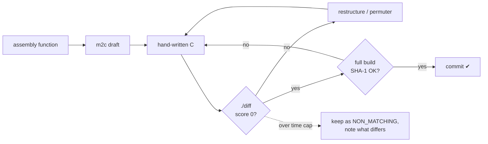

<div align="center">

# 🌊 Wave Race 64: Matching Decompilation

**The Nintendo 64 classic, rebuilt from readable C, byte for byte.**


*US Rev 1 · IDO 5.3 · every build is checked against the original ROM*

</div>

---

## What is this?

Wave Race 64 (Nintendo EAD, 1996) shipped as a compiled MIPS binary. This project turns that
binary back into C source. Compiled with the same compiler Nintendo used (IDO 5.3), that source
produces **exactly the same ROM**, down to the last byte. Every build ends with a SHA-1 check
against the original, so a single wrong instruction fails the build.

Why bother? A matching source tree is the foundation for everything else: understanding how the
water simulation really works, fixing bugs, native ports, and mods far beyond what patching a
binary allows.

This repository is a fork of [LLONSIT/Wave-Race-64](https://github.com/LLONSIT/Wave-Race-64),
which did the groundwork: the ROM split, the build system and the first ~900 functions. This fork
continues from there. See [Credits](#credits) and [How this fork is made](#how-this-fork-is-made).

## Progress

Counted by `tools/progress.py` on `main`. A function counts only when it is C and the ROM still matches.
Size-0 symbols (overlay entry addresses and microcode end markers) are not counted as functions.
Areas follow the linker map: each function belongs to the object whose `.text` holds it; `src/overlays` is
the `ovl_i0`..`ovl_i15` sections, and "other" includes the loose segments that also load at 0x802C5800.
The total became 1348 in milestone 4, when an empty function that splat had counted as part of its
neighbour became its own symbol.

| Area | What's in it | Matched | |
|---|---|--:|---|
| `src/libultra` | Nintendo's N64 OS library | 157 / 157 | `████████████████████` 100% |
| `src/audio` | sequence and sound playback | 226 / 228 | `███████████████████▉` 99.1% |
| `src/overlays` | courses and menu screens | 146 / 151 | `███████████████████▍` 96.7% |
| other | handwritten assembly and loose segments | 53 / 55 | `███████████████████▎` 96.4% |
| `src/codeseg` | HUD, menus, text printer, popups, fades | 197 / 219 | `██████████████████░░` 90.0% |
| `src/game` | race logic, riders, camera, water | 444 / 501 | `█████████████████▊░░` 88.6% |
| `src/sys` | boot, threads, memory | 32 / 37 | `█████████████████▎░░` 86.5% |
| **Total** | | **1255 / 1348** | **93.1%** |

Some functions don't match yet but have a readable C attempt. That attempt is kept beside the
assembly under `#ifdef NON_MATCHING`, with a note on what still differs. `make NON_MATCHING=1`
builds with those attempts, so most of the game can already be read and changed as C.

### Roadmap

- [x] Toolchain and a proven byte-exact rebuild
- [x] HUD, menus, text and popups (`src/codeseg`)
- [ ] Race, riders, camera and water (`src/game`): **in progress**
- [x] Courses and menu screens (`src/overlays`): all but five set-asides
- [ ] The last of the system, audio and loose-segment code: **in progress**
- [ ] Names, structs and documentation everywhere: the "readable" half of the job

## Building

You need your own copy of the game: **Wave Race 64 (USA) (Rev 1)**, `.z64` byte order,
SHA-1 `508dfc2d4caa42b6f6de5263d0aed5e44ac7966a`. It is not included here and never will be.

### Requirements (Linux or WSL)

- `make`, `gcc`, `git`
- MIPS binutils (`binutils-mips-linux-gnu` on Debian/Ubuntu)
- Python 3 with `venv`

### Steps

```bash
git clone https://github.com/nickallevato/wr64-decomp.git
cd wr64-decomp
git submodule update --init --recursive

python3 -m venv .venv && . .venv/bin/activate
pip install -r tools/splat/requirements.txt GitPython colour capstone

make toolchain                       # builds the IDO 5.3 static recompilation and n64crc
cp /path/to/your/wave_race_64.z64 baserom.us.rev1.z64
make init                            # extract + build
```

A good build ends with:

```
waverace64.us.rev1.z64: OK
```

`make NON_MATCHING=1` also builds the not-yet-matching C. The ROM then differs, which is expected.
Run `make clean` before going back to a normal build.

## How matching works



The tools:

- [splat](https://github.com/ethteck/splat) splits the ROM into assembly, data and assets.
- [m2c](https://github.com/matt-kempster/m2c) writes a first C draft from the assembly.
- [asm-differ](https://github.com/simonlindholm/asm-differ) (`./diff <func>`) compares our compiled function with the original, instruction by instruction.
- [decomp-permuter](https://github.com/simonlindholm/decomp-permuter) tries thousands of equivalent rewrites when a function is almost right.
- [ido-static-recomp](https://github.com/decompals/ido-static-recomp) runs Nintendo's original IRIX compiler natively.
- `tools/fork/check.sh` is the one-command proof: a full build, the ROM hash, and a warnings check.

**[FORK.md](FORK.md)** covers the full workflow: a worktree per function, the commit rules, the
NON_MATCHING convention, and what each milestone learned.

## Layout

```
src/
├── libultra/   N64 OS library (complete)
├── sys/        boot, threads, memory, DMA
├── audio/      sound and music
├── codeseg/    HUD, menus, text, popups
├── game/       race, riders, camera, water simulation (water_69D0.c), save data
└── overlays/   per-course and per-screen code, loaded on demand
include/        structs, prototypes, globals
asm/, bin/      generated from your ROM by `make extract` (not in git)
tools/fork/     this fork's matching scripts
```

## How this fork is made

This fork is written with heavy AI assistance from Anthropic's Claude, directed and reviewed by
the maintainer. Every matched function passes the same strict test as any other: the ROM must
rebuild with an identical SHA-1. Nothing is counted on the word of a tool or a model.

The upstream project does not accept AI-generated contributions. This fork is therefore
**independent, and is not affiliated with or endorsed by upstream**. Please don't open pull
requests upstream with code from here.

## Credits

- **[LLONSIT/Wave-Race-64](https://github.com/LLONSIT/Wave-Race-64)** and its contributors:
  the original decompilation, the build system and the first ~900 matched functions.
- **davkdavk**: [LLONSIT/Wave-Race-64#92](https://github.com/LLONSIT/Wave-Race-64/pull/92)
  matched 132 functions. 42 of them were ported into this fork
  ([#1](https://github.com/nickallevato/wr64-decomp/pull/1)), credited in each commit; the rest
  this fork already had or had matched on its own.
- The decomp tooling community: splat, m2c, asm-differ, decomp-permuter, asm-processor and
  ido-static-recomp make all of this possible.

## Legal

This repository contains no ROM data and no Nintendo assets. You must supply your own legally
obtained copy of the game. Wave Race 64 is © Nintendo. This is an unofficial, non-commercial
preservation and research project.
